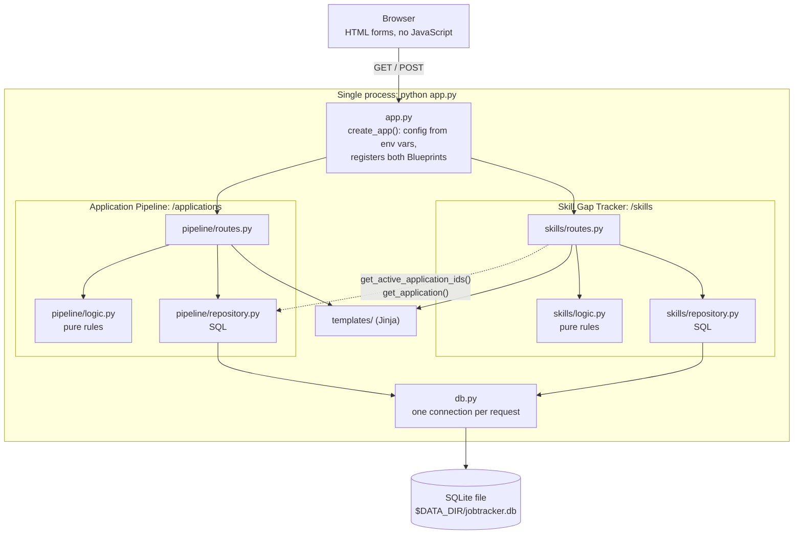
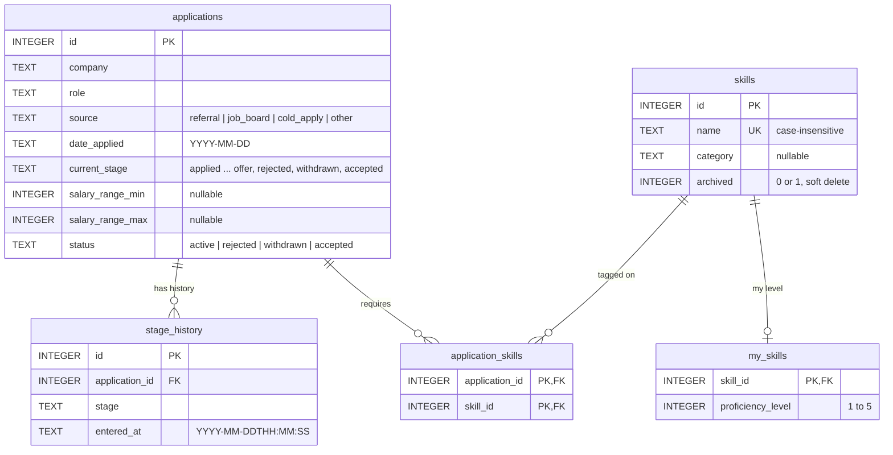

# Job Search Tracker

A personal web app for tracking job applications through a hiring pipeline and finding which skills to improve based on the jobs applied to.

## Features

**Application Pipeline** (`/applications`)
- Add applications with company, role, source (referral, job board, cold apply, other), date applied and an optional salary range.
- Move an application through the stages applied → phone screen → technical assessment → interview → final round → offer. Stages can be skipped forward but never moved backwards; rejected and withdrawn can be reached from any stage, and an offer can be accepted. All three close the application.
- Every stage change is recorded with a timestamp, and each application shows how many days it has been in its current stage.
- Applications with no movement for more than `STALE_DAYS` days are flagged as stale.
- Conversion rates between stages, grouped by source.

**Skill Gap Tracker** (`/skills`)
- Keep a list of skills and rate my own level from 1 to 5.
- Tag the skills each application requires.
- See which skills are missing, ranked by how many active applications want them, and a priority score (`applications wanting it × (5 − my level)`) for what to learn first. Rejected, withdrawn and accepted applications drop out of the ranking automatically.
- Archiving a skill hides it from new tagging but keeps it on applications that already had it (soft delete).

## Run locally

```bash
python3 -m venv .venv
source .venv/bin/activate
pip install -r requirements.txt
python app.py
```

Then open http://localhost:8000.

**Alternative with [uv](https://docs.astral.sh/uv/):** if uv is installed, it creates the environment and installs from the same `requirements.txt` in one step (no venv or activate needed):

```bash
uv run --no-project --with-requirements requirements.txt python app.py
```

`requirements.txt` stays the project's only dependency manifest; uv just reads it.

## Configuration

| Variable | Default | Purpose |
|---|---|---|
| `PORT` | `8000` | Port the server listens on (always binds `0.0.0.0`) |
| `DATA_DIR` | `./data` | Folder where the SQLite database file is stored |
| `STALE_DAYS` | `14` | Days without stage movement before an application is flagged stale |
| `SECRET_KEY` | `dev-only-change-me` | Signs the session cookie used for flash messages; set a random value outside local use |

The SQLite database is stored at `$DATA_DIR/jobtracker.db` (by default `./data/jobtracker.db`). The folder and all tables are created automatically on startup, so there is no setup or migration step, and restarting keeps existing data.

## Running the tests

With the virtual environment active:

```bash
pytest --cov=pipeline --cov=skills --cov-report=term-missing
```

Or with uv, without setting up a virtual environment first:

```bash
uv run --no-project --with-requirements requirements.txt pytest --cov=pipeline --cov=skills --cov-report=term-missing
```

Result (2026-10-11, 154 tests):

```
Name                     Stmts   Miss  Cover   Missing
------------------------------------------------------
pipeline/__init__.py         0      0   100%
pipeline/logic.py           84      0   100%
pipeline/repository.py      42      0   100%
pipeline/routes.py          49      0   100%
skills/__init__.py           0      0   100%
skills/logic.py             41      0   100%
skills/repository.py        52      0   100%
skills/routes.py            75      0   100%
------------------------------------------------------
TOTAL                      343      0   100%
154 passed
```

What the tests cover:

| Test file | What it checks |
|---|---|
| `tests/test_pipeline_logic.py` | Stage transition rules, days in stage, stale flag, conversion rates, form parsing |
| `tests/test_skills_logic.py` | Demand counts, missing skills, demand ranking, priority score, form parsing |
| `tests/test_pipeline_repo.py`, `tests/test_skills_repo.py` | SQL against a real temporary SQLite database (pytest `tmp_path`), including soft delete |
| `tests/test_pipeline_routes.py`, `tests/test_skills_routes.py` | A few end-to-end checks of each page through Flask's test client |
| `tests/test_app_config.py` | Deployment contract: `PORT`, `DATA_DIR` and `STALE_DAYS` come from environment variables, and the database file is created at `$DATA_DIR/jobtracker.db` |

## Architecture

One Python process (`python app.py`) serves server-rendered HTML pages. Every action is an HTML form POST followed by a redirect; there is no client-side JavaScript. Each domain is a Flask Blueprint split into pure business rules (`logic.py`), SQL (`repository.py`) and HTTP handling (`routes.py`).



The dotted arrow is the only link between the domains, and it only goes one way: the skills domain calls two pipeline repository functions, and the pipeline never imports anything from skills. In a future service split, those two calls become HTTP requests (see ADR-2).

## Database schema

Five tables in one SQLite file, created by `schema.sql` on startup. `application_skills` is the only table that connects the two domains (see ADR-3).



## Project structure

```
app.py                  Entry point: create_app(), env var config, starts the server
db.py                   SQLite connection helpers and schema setup
schema.sql              The five tables (CREATE TABLE IF NOT EXISTS)
requirements.txt        Flask, pytest, pytest-cov
pytest.ini              Test settings
pipeline/
    logic.py            Stage rules, days in stage, stale flag, conversion rates, form parsing
    repository.py       SQL for applications and stage_history
    routes.py           /applications pages
skills/
    logic.py            Demand counts, missing skills, ranking, priority score, form parsing
    repository.py       SQL for skills, my_skills and application_skills
    routes.py           /skills pages
templates/              Jinja templates (base.html, pipeline/, skills/)
static/style.css        Styling
tests/                  pytest suite (see "Running the tests")
ADR.md                  Architecture Decision Records
AI_USAGE.md             AI usage log
```
